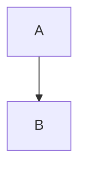

# react-simple-markdown-editor

A React component to edit and preview Markdown, with toolbar presets and Mermaid diagram support.


*Editing with the default toolbar*


*Live preview with rendered Mermaid diagram*

## Installation

```bash
npm install react-simple-markdown-editor
```

Requires `react >= 18` and `react-dom >= 18` (peer dependencies). Markdown
rendering dependencies (`react-markdown`, `remark-gfm`, `rehype-raw`,
`mdx-mermaid`) are also peer dependencies — install the ones you use:

```bash
npm install react-markdown remark-gfm rehype-raw mdx-mermaid
```

Styles are injected automatically; no CSS import needed.

## Usage

```tsx
import { useState } from "react";
import { MarkdownEditor } from "react-simple-markdown-editor";

export function App() {
  const [value, setValue] = useState("# Hello\n\nEdit me!");

  return <MarkdownEditor value={value} onChange={setValue} rows={10} />;
}
```

### Props

| Prop           | Type      | Default | Description                                   |
| -------------- | --------- | ------- | --------------------------------------------- |
| `value`        | `string`  | —       | Current Markdown content                      |
| `onChange`     | `(v) => void` | —   | Called with the new content on every change, including toolbar insertions |
| `rows`         | `number`  | `5`     | Visible textarea rows                         |
| `previewMode`  | `boolean` | `false` | Start with the preview open                   |
| `config`       | `MarkdownEditorConfig` | default preset | Toolbar preset or custom button list |

### Toolbar presets

```tsx
// compact | default | full presets, or pick your own buttons:
<MarkdownEditor
  value={value}
  onChange={setValue}
  config={{ toolbarConfig: "full" }}
/>

<MarkdownEditor
  value={value}
  onChange={setValue}
  config={{ toolbarConfig: "custom", customToolbarButtons: ["Bold", "Italic", "Link"] }}
/>
```

Available buttons: Bold, Italic, Strikethrough, Underline, Heading 1–6,
Bullet/Numbered/Task lists, Blockquote, Horizontal Rule, Link, Image, Table,
Inline Code, Code Block, Mermaid Diagram, Superscript, Subscript,
Center Align, HTML Block.

### Mermaid diagrams

Fenced `mermaid` code blocks render as diagrams via `mdx-mermaid`:

````markdown

````

## Development

```bash
npm install
npm test        # jest
npm run lint    # eslint
npm run build   # rollup -> dist/
```

## License

ISC
